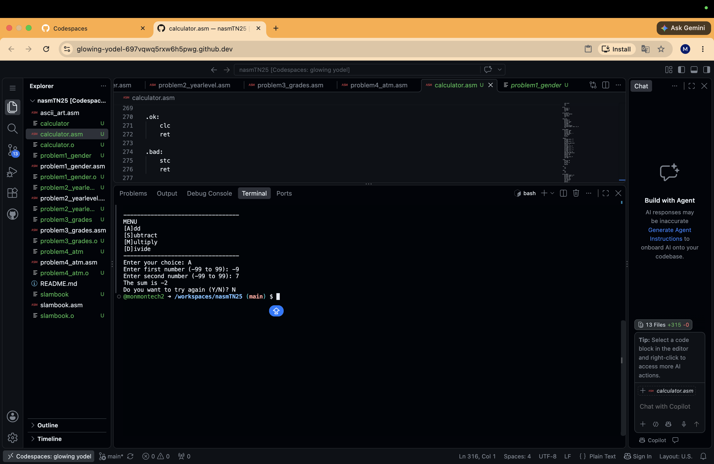
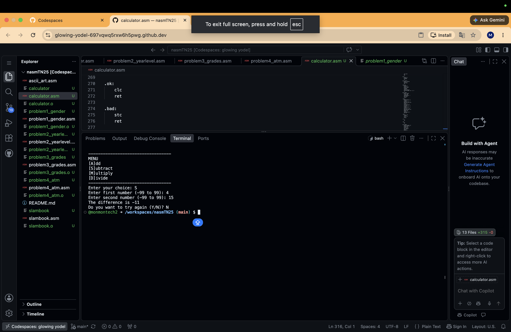
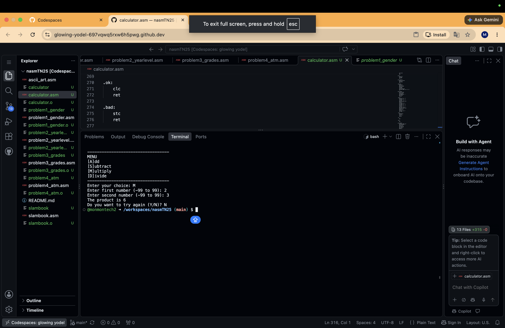
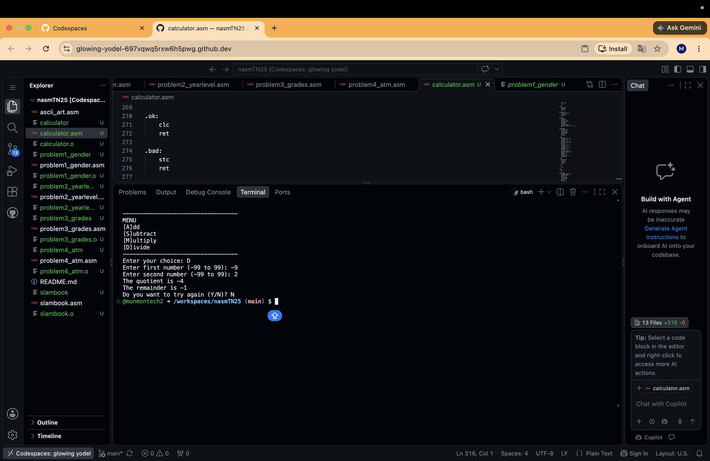

# NASM32 Menu-Driven Calculator

## 1. Project Description

This project is a menu-driven calculator written in NASM32 Assembly Language. It performs addition, subtraction, multiplication, and division.

## 2. Features

- Supports addition, subtraction, multiplication, and division.
- Accepts positive and negative integers from -99 to 99.
- Supports two-digit inputs.
- Clears the screen when returning to the menu.
- Asks the user whether to try again.
- Handles invalid menu choices and division by zero.
- Displays the quotient and remainder for division.

## 3. Compilation and Execution

Compile the assembly source code:

```bash
nasm -f elf32 calculator.asm -o calculator.o
```

Link the object file:

```bash
ld -m elf_i386 calculator.o -o calculator
```

Run the calculator:

```bash
./calculator
```

## 4. Test Cases

### Addition

| Test | First Number | Second Number | Expected Result |
|---|---:|---:|---|
| 1 | 2 | 3 | 5 |
| 2 | 12 | 23 | 35 |
| 3 | -9 | 7 | -2 |

### Subtraction

| Test | First Number | Second Number | Expected Result |
|---|---:|---:|---|
| 1 | 8 | 3 | 5 |
| 2 | 25 | 12 | 13 |
| 3 | 4 | 15 | -11 |

### Multiplication

| Test | First Number | Second Number | Expected Result |
|---|---:|---:|---|
| 1 | 2 | 3 | 6 |
| 2 | 12 | 11 | 132 |
| 3 | -9 | 7 | -63 |

### Division

| Test | First Number | Second Number | Expected Result |
|---|---:|---:|---|
| 1 | 6 | 3 | Quotient: 2, Remainder: 0 |
| 2 | 25 | 4 | Quotient: 6, Remainder: 1 |
| 3 | -9 | 2 | Quotient: -4, Remainder: -1 |

## 5. Program Explanation

The program displays a menu and asks the user to choose an operation. It then requests two numbers and calculates the answer using the appropriate assembly instruction.

- `add` performs addition.
- `sub` performs subtraction.
- `imul` performs signed multiplication.
- `idiv` performs signed integer division.

The program displays the result and asks whether the user wants to try again. Entering `Y` returns to the menu, while entering `N` terminates the program.

Division displays an integer quotient and remainder, not a decimal result.

## 6. Screenshot Evidence

Include screenshots showing the compilation process and the actual output for all 12 test cases:

- 3 addition tests
- 3 subtraction tests
- 3 multiplication tests
- 3 division tests

## 7. GitHub Repository

https://github.com/monmontech2/nasmTN25

## 8. Compilation Screenshot


## 9. Addition Test Cases

### Test Case 1: 2 + 3 = 5


### Test Case 2: 12 + 23 = 35


### Test Case 3: -9 + 7 = -2



## 10. Subtraction Test Cases

### Test Case 1: 8 - 3 = 5


### Test Case 2: 25 - 12 = 13


### Test Case 3: 4 - 15 = -11



## 11. Multiplication Test Cases

### Test Case 1: 2 x 3 = 6



### Test Case 2: 12 x 11 = 132


### Test Case 3: -9 x 7 = -63


## 12. Division Test Cases

### Test Case 1: 6 / 3 = 2


### Test Case 2: 25 / 4 = 6 remainder 1


### Test Case 3: -9 / 2 = -4 remainder -1


